# OpsPilot

**An AI-assisted incident triage prototype that shows its evidence, states its uncertainty, and leaves every consequential decision to a human.**

> **Status: independent 0→1 product exploration.** OpsPilot is a self-initiated portfolio prototype, not a shipped product. The user, problem and design bets are working hypotheses, not findings from user research. All AI output is **pre-authored and deterministic** so every demo and test session behaves identically; no model is called at runtime. Nothing in the prototype touches real systems.
### Prototype scope

This prototype uses deterministic, pre-authored scenario data. It does not call a live AI model, backend service, authentication system, or production incident-management platform. The interaction logic, decision gating, audit behavior, and UI states are implemented in the frontend to demonstrate the intended product behavior.
---
## Live prototype

[Open the live OpsPilot prototype](https://opspilot-ai-incident-triage-six.vercel.app/)

Deployed on Vercel from the `main` branch. New commits to `main` trigger an automatic deployment.
---

## The scenario

At 06:00 the RADIUS server certificate on `nps-bldga-01` expires. Twelve Building A workstations authenticate to the network through that server (802.1X), so between 06:01 and 06:09 they fail authentication and drop offline. Monitoring raises twelve separate "host unreachable" alerts. OpsPilot groups them into one incident, shows what was observed, explains the likely cause with evidence and confidence, and recommends actions the operator can approve, modify, dismiss or escalate. Every decision is written to an audit trail.

### Demo scenarios

The demo starts on the Operations Dashboard with INC-2041 open, the Base scenario and no decisions recorded. Switch scenarios from the **Demo scenario** control at the top of Incident Detail (prototype tooling, styled as such). Each switch resets the incident.

| Scenario | What it demonstrates |
| --- | --- |
| **Base** | High confidence. Certificate expiry confirmed by authentication logs. The consequential fix is available but needs typed confirmation. |
| **Low confidence** | NPS logs unavailable. A competing hypothesis is shown. The consequential fix is blocked; verify, dismiss and escalate remain. |
| **Stale analysis** | Three new events arrive after the analysis. Approval is blocked. Acknowledging reopens low-risk actions only; the consequential fix requires a re-run. |

---

## AI UX rules

These rules come from the product spec and are enforced in code, not just in the UI. Full detail: [`docs/ai-behavior-contract.md`](docs/ai-behavior-contract.md).

1. **Never hide uncertainty.** Every conclusion shows a confidence band (High, Medium, Low) with a one-line reason. No bare percentages.
2. **Show evidence.** Every AI inference links to the observed events behind it. The fixture-integrity test fails the build if an inference cites nothing.
3. **Separate facts from inference.** Observed facts and AI output live in separate page regions, and every AI statement carries a provenance tag: Observed, Inferred or Unknown.
4. **Human confirmation for consequential actions.** Approving a consequential change requires typing the target system's name. Approval creates a (mock) change request; nothing runs from OpsPilot.
5. **Users can reject or modify.** Dismiss and Escalate are never blocked by confidence or staleness. Modify shows a was/now diff.
6. **Audit everything.** Each decision records actor, time, action, reason or diff, flags, and a frozen copy of the analysis it was made against. The log is append-only.
7. **Do not fabricate.** Missing information appears as *Unknown* with a reason, never as a guess.

The rules are implemented once, in [`src/domain/gate.ts`](src/domain/gate.ts), and tested exhaustively (720 input combinations).

---

## Design decisions

The short version; reasoning and alternatives are in [`docs/design-decisions.md`](docs/design-decisions.md).

- **Facts left, AI right.** Two landmark regions keep provenance structural, not just visual.
- **Trace, don't trust.** Any evidence item highlights its source event and system; *Show source* jumps there and *Back to evidence* returns.
- **Categorical confidence.** Bands with reasons, because pre-authored or model-generated percentages imply precision nobody has.
- **Stale analysis is a safety rule.** Consequential actions always need fresh analysis; acknowledging staleness is not enough.
- **One scroll area, reserved decision dock.** The workspace scrolls as one; the DecisionBar sits in a reserved zone below it, so content and focus never sit behind it. No independent column scrolling.
- **Spend boldness on seven signature components** (below); everything generic stays plain.

---

## Architecture

```mermaid
flowchart LR
  F[Fixtures<br/>events, systems,<br/>analyses, scenarios] --> S[StoreProvider<br/>reducer, selectors]
  S --> SC[Screens<br/>Dashboard, Incident, Audit]
  SC -->|props + gateResult| C[Components<br/>signature: data only<br/>supporting: plain]
  C -->|callbacks| SC
  SC -->|dispatch action| S
  G[gate&#40;&#41;<br/>availability rules] --> SC
  G -->|re-check on submit| S
  T[TraceProvider<br/>highlight, return point] <--> C
```



- **`src/domain`** holds plain TypeScript with no React: types, `gate()`, the reducer and selectors. The rules read like the spec.
- **One reducer, one store context, one trace context.** No state library.
- **Signature components never dispatch.** Screens pass them data and a precomputed `gateResult`, so each one renders in isolation.

More: [`docs/architecture.md`](docs/architecture.md).

### Signature components

The seven components that carry the product idea, built first and given the strongest visual and interaction treatment:

| Component | Job |
| --- | --- |
| `ProvenanceTag` | Marks every AI statement as Observed, Inferred or Unknown |
| `EvidenceItem` | Ties an inference to a real event; starts the trace |
| `ConfidenceIndicator` | Band plus reason; never colour alone |
| `HypothesisCard` | Cause, confidence, supporting and counter-evidence, unknowns |
| `RecommendationCard` | A proposal with risk tier, impact and rollback, never an instruction |
| `DecisionBar` | Approve, Modify, Dismiss, Escalate, gated with stated reasons |
| `AuditEntry` | The decision plus the frozen analysis it was made against |

### Folder map

```text
src/
  domain/        types, gate(), reducer, selectors, demo clock (+ tests)
  fixtures/      pre-authored events, systems and analyses (+ integrity test)
  state/         store and scenario timers, trace, decision dock slot, dashboard memory, route effects
  components/
    signature/   the seven signature components
    supporting/  shell, tables, timeline, dialogs, banners, queue
  screens/       Dashboard, Incident Detail, Audit tab
  styles/        tokens.css (foundation + semantic), base.css
  dev/           developer pages (foundation check, component gallery)
docs/            AI behaviour contract, design decisions, architecture, screenshots/ (final set)
scripts/         contrast audit, browser accessibility and QA scripts, visual regression
```
---
## Where to start in the code
If you are picking up the project for the first time, these are the main entry points:

| Area | Start here |
| --- | --- |
| Application flow and screens | `src/screens/` |
| Decision and safety gating | `src/domain/gate.ts` |
| State transitions and audit behavior | `src/domain/reducer.ts` |
| Shared domain types | `src/domain/types.ts` |
| Application state | `src/state/` |
| Reusable UI components | `src/components/` |
| Design tokens | `src/styles/tokens.css` |
| Prototype scenarios and fixture data | `src/fixtures/` |
| Architecture rationale | `docs/architecture.md` |
| Design decisions | `docs/design-decisions.md` |
| AI behavior contract | `docs/ai-behavior-contract.md` |

For product behavior, start with the screens and domain layer. For visual implementation, start with the component and token layers. For deeper context behind the implementation choices, see the documents in `docs/`.
---

## Getting started

Requires Node 24 or later (see `.nvmrc`).

```bash
npm ci
npm run dev        # http://localhost:5173
```
Before handing off or submitting changes, run `npm run check`. It runs the test suite, TypeScript checks, ESLint, and the production build.

`/` is the Operations Dashboard; `/incidents/INC-2041` is Incident Detail. In development, `/?demo=loading` and `/?demo=empty` show the Dashboard's loading and empty states.

**Development-only pages:** `/dev/gallery` shows every signature component state; `/dev/foundation` shows what `gate()` allows per scenario. Both are excluded from production builds.

| Script | What it does |
| --- | --- |
| `npm run dev` | Start the dev server |
| `npm test` | Run all tests once |
| `npm run test:watch` | Run tests on change |
| `npm run typecheck` | TypeScript, strict mode |
| `npm run lint` | ESLint with accessibility rules (jsx-a11y) |
| `npm run check` | Run tests, typecheck, lint, and production build |
| `npm run build` | Typecheck, then build static files to `dist/` |
| `npm run preview` | Serve the production build locally |

## Testing
Every push and pull request to `main` is automatically verified with GitHub Actions.

The CI workflow runs:

- `npm ci`
- `npm run check`

`npm run check` runs the full test suite, TypeScript type checking, ESLint, and the production build. A passing CI run confirms that the repository installs cleanly and passes the project's developer verification checks.
243 tests in 18 files (Vitest, React Testing Library, axe-core):

- **`gate()`**: all 720 combinations of analysis status, confidence, tier, recommendation status and incident status, plus five invariants (for example, *acknowledged stale analysis never allows a consequential action*).
- **Reducer and audit integrity**: allowed and refused transitions, atomic decision writes, action-specific flags, frozen and immutable snapshots, deterministic chronology, timer callbacks from an old scenario ignored.
- **Fixture integrity**: every cited id exists, every inference has evidence, every unknown has a reason.
- **Signature components**: accessible names, keyboard behaviour, every variant, blocked-state messaging, axe checks.
- **Screens and flows**: Dashboard, Incident Detail, Low confidence and Stale scenarios (with fake timers), Audit, route titles and focus.

```bash
npm run check
python3 scripts/contrast-audit.py                     # 97 token pairings + semantic alias check
```

Browser suites (need Python with Playwright and Chromium) run against a served build:

```bash
npx vite preview --port 4173 &
python3 scripts/a11y-browser-audit.py http://localhost:4173     # Incident Detail: axe, keyboard, focus, zoom
python3 scripts/a11y-dashboard-audit.py http://localhost:4173   # Dashboard
python3 scripts/a11y-scenarios-audit.py http://localhost:4173   # Low confidence, Stale, Audit
python3 scripts/qa-browser.py http://localhost:4173             # end-to-end workflows, focus sweep, responsive, runtime
python3 scripts/visual-regression.py capture <dir> http://localhost:4173   # pixel baseline; then: compare <before> <after>
```

## Accessibility

Designed and audited against WCAG 2.2 AA criteria within the prototype's supported scope.

The supported scope is the Operations Dashboard, Incident Detail and all three demo scenarios at 1024–1440 CSS px, including 200% zoom equivalents. Real screen-reader testing, Firefox and Safari, forced colours and layouts below 1024 px are not yet covered; [`QA-REPORT.md`](QA-REPORT.md) includes a manual checklist for VoiceOver and NVDA.

The full audit (measured contrast for every token pairing, keyboard and focus results, fixes and limitations) is in [`ACCESSIBILITY-AUDIT.md`](ACCESSIBILITY-AUDIT.md).

## Design tokens

Colours live in `src/styles/tokens.css` in two layers.

- **Foundation tokens** (`--color-*`) hold the reusable audited colour values used for semantic UI meaning. Component-local translucent effects such as shadows, overlays and decorative glows may remain local when they do not represent reusable semantic colour decisions.
- **Semantic tokens** describe UI intent and are aliases of foundation tokens, so they cannot change a value: generic ones (`--background`, `--foreground`, `--card`, `--popover`, `--primary`, `--muted`, `--muted-foreground`, `--accent`, `--destructive`, `--border`, `--input`, `--control-border`, `--ring`, `--sidebar-*`) and OpsPilot ones that encode product meaning (`--observed`, `--inferred-*`, `--unknown`, `--critical`, `--major`, `--minor`, `--info`, `--warning`, `--success`, `--consequential`, `--evidence-trace`, `--ai-*`, `--decision-*`).

Components should prefer semantic tokens, and product meaning wins over generic categories: an Inferred label uses `--inferred-text`, not `--primary`; Critical severity uses `--critical`, not `--destructive`; the active trace uses `--evidence-trace`. `--border` is decorative only; interactive controls use `--control-border` or `--input` (the audited ≥ 3:1 boundary).

Accessibility-critical colours must not change without rerunning `python3 scripts/contrast-audit.py` (which also checks that every semantic alias resolves) and the browser accessibility scripts. `scripts/visual-regression.py` compares screenshots pixel by pixel when a refactor should not change appearance.

## Deployment

`npm run build` produces a static `dist/` folder that any static host can serve (Netlify, Vercel, GitHub Pages, Cloudflare Pages). Configure the host to serve `index.html` for unknown paths so deep links and refreshes work: `/`, `/incidents/INC-2041`, `/incidents/INC-2041?tab=audit`. Unknown incidents and unknown paths render in-app "Incident not available" and "Page not found" pages. Development-only pages are not included in the build.

---

## Build status

The build follows the sequence in the implementation plan.

| Phase | Scope | Status |
| --- | --- | --- |
| 1. Foundation | Types, fixtures, `gate()`, reducer, tokens, tests | Done |
| 2. Signature components | The seven components, in a gallery | Done |
| 3. Incident Detail | Regions, trace, decision flow, audit tab (base scenario); visual system v2; accessibility pass | Done |
| 4. Dashboard | Queue, grouping preview and panel, site health, return state | Done |
| 5. Scenario states | Low confidence, stale timers, re-run, acknowledge | Done |
| 6. Audit integrity | Complete, frozen, immutable entries; flags; system events; chronology | Done |
| 7. Accessibility and QA | End-to-end, keyboard, focus, responsive, zoom, reduced motion, runtime ([QA report](QA-REPORT.md)) | Done |
| 8A. Semantic tokens | Semantic token layer over the audited values; no visual change | Done |
| 8B. Final polish and packaging | Consistency review, repository cleanup, final screenshots | Done |

## Limitations

- A prototype with one scripted incident and pre-authored fixtures; no model, integration or persistence. State is in memory, so a refresh returns to the Base scenario.
- Displayed time is a logical demo clock, so chronology is deterministic rather than wall-clock.
- Modify keeps the original risk tier; re-tiering a riskier modification is specified only.
- Supported widths are 1024 px and up; narrower viewports get a basic single-column fallback.
- Accessibility limits are listed above and in the audit.

### Specified but not built

Global audit log screen, a standalone missing-data scenario, AI-unavailable state, permissions, risky modifications re-tiering into a new tier, self-resolving and duplicate incidents. These are designed in the spec so the concept holds up under questioning.

## Credits

Typeface: IBM Plex (SIL Open Font License), via Fontsource.
