# Architecture

OpsPilot is a static React + TypeScript single-page app. There is no backend and no network call.

## Data flow

```mermaid
flowchart LR
  F[Fixtures] --> S[StoreProvider: reducer + selectors]
  S --> SC[Screens]
  SC -->|props + gateResult| C[Components]
  C -->|callbacks| SC
  SC -->|dispatch| S
  G[gate&#40;&#41;] --> SC
  G -->|re-check on submit| S
  T[TraceProvider] <--> C
```



1. **Fixtures** (`src/fixtures`) seed the store with a scenario's events and analysis.
2. **The reducer** (`src/domain/reducer.ts`) owns all product state, including the logical demo clock. It is pure and deterministic; timer callbacks carry a scenario token.
3. **Screens** read state, compute `gate()` results, and pass plain data to components.
4. **Components** render and call back. Signature components never dispatch, so they render in isolation.
5. **`gate()`** (`src/domain/gate.ts`) decides availability. Screens call it to render; the reducer calls it again on submit, because analysis can go stale while a dialog is open.
6. **TraceProvider** holds UI-only state for the evidence → event → system trace.

## State machines

| Machine | States | Notes |
| --- | --- | --- |
| Incident | open → in_review → decided / escalated | Approving read-only or low-impact cards, or dismissing, leaves it in review |
| Analysis | analyzing ↔ ready → stale → acknowledged | Only re-run returns to ready |
| Recommendation | pending → approved / modified / dismissed / escalated | "Blocked" is computed, never stored |
| Decision | idle → drafting → recorded | Cancel writes nothing |

## Signature component tree

```text
HypothesisCard
├─ ProvenanceTag (Inferred, on the cause)
├─ ConfidenceIndicator
├─ EvidenceItem × n            supporting
├─ EvidenceItem × n            counter-evidence, each with an Inferred explanation
└─ ProvenanceTag (Unknown) × n

RecommendationCard
├─ ProvenanceTag (Inferred, on the rationale)
├─ EvidenceItem × 1–2
└─ risk tier · reversible · impact · rollback

DecisionBar
├─ selected RecommendationCard summary
├─ ConfirmDialog (typed for consequential)
├─ ActionEditor → ConfirmDialog
└─ ReasonDialog (dismiss, escalate)

AuditEntry
├─ decision record
└─ frozen analysis (read-only HypothesisCard, RecommendationCard)
```

## Time

**Displayed time is logical and deterministic** (`src/domain/clock.ts`). The store keeps a `clock` that starts at 06:12. Each recorded action is stamped 30 seconds after the latest thing on screen. When late events arrive, the clock first jumps to the newest event; when a re-run completes, the new analysis is stamped no earlier than its fixture time and 30 seconds after the re-run started. A decision can therefore never appear earlier than an event or analysis already shown, and the same actions always produce the same timestamps.

**Real time only triggers timers.** Two exist, both owned by `StoreProvider`: late-event arrival (3 s after Incident Detail first opens in the stale scenario) and re-run analysis (1.5 s). Both carry the scenario token; `setScenario` clears pending timers, and the reducer ignores callbacks from a previous scenario.
